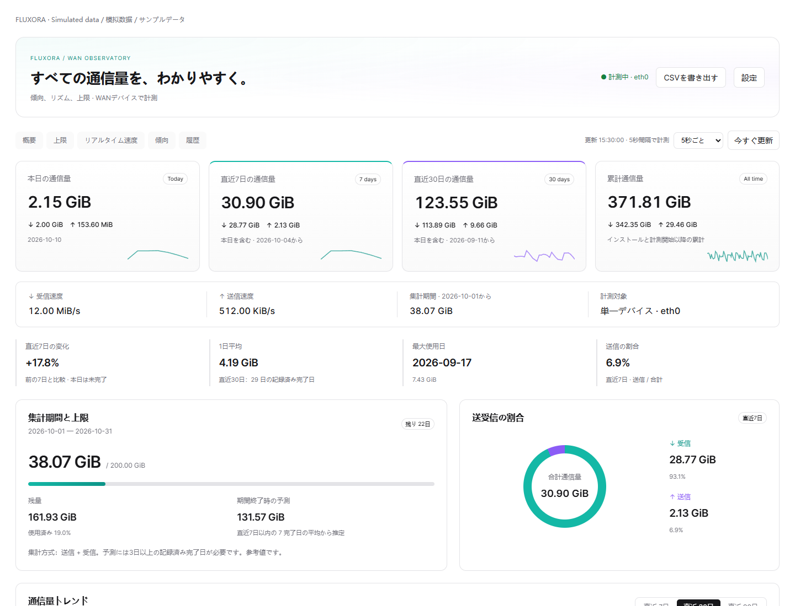

<div align="center">


**すべての通信量を、わかりやすく。OpenWrt のための WAN ダッシュボード。**

[](https://github.com/cndoin/luci-app-fluxora/releases)
[](https://github.com/cndoin/luci-app-fluxora/actions)
[](LICENSE)


[English](README.md) · [简体中文](README.zh-CN.md) · **日本語**

[ダウンロード](https://github.com/cndoin/luci-app-fluxora/releases/latest) · [互換性とテスト](docs/COMPATIBILITY.md) · [変更履歴](CHANGELOG.md)

</div>



実際のコードを**サンプルデータ**で表示しています。LuCI 内で動作し、別のウェブサイトや GitHub Pages は公開しません。英語・簡体字中国語・日本語に対応します。

## 主な機能

| ビュー | 内容 |
| --- | --- |
| 概要 | 本日・直近7日・直近30日・累計の送受信量 |
| リアルタイム | 速度、15分グラフ、計測ピーク、短期 P95、帯域使用率 |
| 傾向 | 時間帯別・曜日別、91日カレンダー、使用量上位5日 |
| 集計期間 | 毎月の開始日、上限、残量、終了時の予測 |
| 履歴 | 日別・期間別・月別・年別、ページ表示と CSV 出力 |
| デバイス | パケット、ドライバーエラー / 破棄、計測時間 |

ライト / ダーク、モバイル表示、穏やかなアニメーション。動きを無効にでき、システムの低減設定も尊重します。更新は2 / 5 / 10 / 15 / 30 / 60秒または手動を選択可能。非表示タブは取得を停止し、計測は継続します。

<details>
<summary>リアルタイム速度、カレンダー、ダーク表示、モバイル</summary>


</details>

## インストール

CPU ではなく**パッケージマネージャー**で選びます。Shell と JavaScript のみなので、ARM32・ARM64・x86/64 で同じ `all.ipk` / `noarch.apk` を利用できます。ARM / x86 の ZIP も同じ汎用パッケージを収録します。

| ファームウェア | ファイル |
| --- | --- |
| OpenWrt 23.05 / 24.10、opkg の iStoreOS 24.10 | `luci-app-wan-traffic_1.4.0-1_all.ipk` |
| apk の OpenWrt 25.12 | `luci-app-wan-traffic-1.4.0-r1.apk` |
| 独自ビルド / Snapshot | [互換性](docs/COMPATIBILITY.md)とマネージャーを確認 |

ファイルを `/tmp` にアップロードして実行します。

```sh
# opkg
opkg install /tmp/luci-app-wan-traffic_1.4.0-1_all.ipk

# apk — コミュニティ配布は OpenWrt の公式鍵で署名されていません
apk add --allow-untrusted /tmp/luci-app-wan-traffic-1.4.0-r1.apk
```

依存関係が不足する場合は `opkg update` または `apk update` 後に再試行してください。Release の `SHA256SUMS` で照合します。IPK の拡張子を APK に変えても利用できません。

再ログインし、**サービス → Fluxora 流光 → 設定**から変更を保存・適用します。既存の `luci-app-wan-traffic` から直接更新でき、設定と履歴を保持します。互換性のためパッケージ名を維持します。

新規では論理 `wan` から自動検出します。必要なら `eth0` などを指定します。実際の WAN デバイスは**1つだけ**選択し、同じポートの WAN / WAN6 は合算しません。毎月1～28日の開始日を設定でき、日別履歴は削除しません。

## 計測の範囲と制約

WAN の RX / TX を使用し、IPv4、IPv6、ルーター通信、実際のプロキシのオーバーヘッドや再送を含みます。OpenClash / UA3F / TUN / LAN の値は追加しません。一般的な仮想デバイスは既定で拒否し、詳細設定で1つ許可できます。

統計レイヤーの二重計上を避けますが、実際のパケットの重複排除は行いません。ISP の請求量と一致する保証はありません。受信のみ課金の場合は集計方式を「受信のみ」にしてください。

- インストール前の通信量は復元できません。
- 日別履歴は `/etc/wan-traffic/` に保存し、通常の再起動で保持します。突然の電源断は最大1保存間隔分（既定60秒）を失う場合があります。
- 時間別履歴は90日、速度180件は RAM のみで再起動後に再蓄積します。
- 直近7 / 30日は本日を含む暦日で計算します。
- 予測には3日以上の記録済み完了日が必要で、参考値です。破棄数はエンドツーエンドの損失率ではありません。
- 端末・アプリ・ドメイン別ランキングは算出できません。

## 軽量設計と検証

5秒間隔の計測とページ取得を分離し、履歴は約1分ごとに同期します。SVG / カードを再利用し、重複リクエストを防ぎ、離脱時にリスナーと動きを解除します。ルーターにデータベース、Python、Node、React、パケットキャプチャ、CDN は不要です。

差分、初期化、再起動復元、時間境界、仮想デバイス、大きな値、インストール、ブラウザーを検証します。250回の更新で DOM 数は安定し、同時リクエストは最大1件でした。[テスト範囲](docs/COMPATIBILITY.md)に実機とエミュレーションの違いを記載しており、全独自ファームウェアの長期安定性を保証するものではありません。

## 開発・ライセンス

```sh
python3 build.py
python3 build.py --format all   # apk-tools v3 が必要
python3 test_backend.py
npm ci && npx playwright install chromium
npm test
```

SDK / buildroot 用 Makefile、CI、Issue テンプレート、[貢献ガイド](CONTRIBUTING.md)を含みます。Python / Node は開発専用です。

[MIT](LICENSE)。AnxForever の MIT shadcn analytics template を視覚的な参考とし、[表示を保持](root/usr/share/doc/luci-app-wan-traffic/TEMPLATE-LICENSE)しています。ネイティブ LuCI 実装です。参考：[vnStat](https://github.com/vergoh/vnstat)、[nlbwmon](https://github.com/jow-/nlbwmon)、[Linux 統計](https://docs.kernel.org/networking/statistics.html)。
