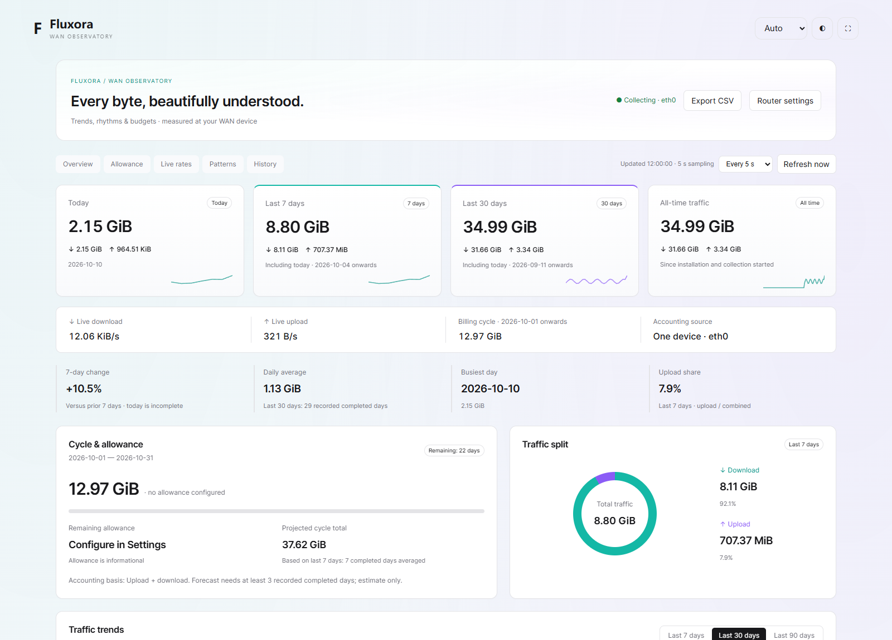

<div align="center">


**A calm, local-first WAN traffic observatory for OpenWrt.**

[](https://github.com/cndoin/luci-app-fluxora/releases)
[](https://github.com/cndoin/luci-app-fluxora/actions)
[](LICENSE)


**English** · [简体中文](README.zh-CN.md) · [日本語](README.ja.md)

[Download](https://github.com/cndoin/luci-app-fluxora/releases/latest) · [Compatibility](docs/COMPATIBILITY.md) · [Changelog](CHANGELOG.md) · [Contribute](CONTRIBUTING.md)

</div>


Screenshots render the actual dashboard code with **simulated data**. Fluxora runs inside LuCI, with an optional local standalone dashboard. No hosted website or GitHub Pages is deployed.

## Standalone LAN dashboard

Enable **Standalone LAN dashboard** in LuCI → Services → Fluxora → Manual settings, choose a port (default **8810**) and LAN interface (default `lan`), then **Save & Apply** and reload LuCI. Click **Open standalone dashboard**, or visit `http://<router-LAN-IP>:8810/`.

The optional page has its own layout, language selector, remembered light/dark theme and fullscreen control. It shares the collector and history with LuCI; disabling the switch stops the extra listener. It is **read-only and has no login**: devices able to reach that LAN address can see aggregate traffic. Configuration remains in authenticated LuCI. Use on a trusted LAN; do not forward this port. Only the selected interface’s private IPv4 address is bound; no WAN firewall allowance is created. Port collisions prevent the listener from starting: choose another unused port. Router hostnames and IPv6 URLs are not supported by this listener. The “Router settings” shortcut assumes LuCI HTTP port 80; use your usual LuCI URL for custom ports/HTTPS.



## See the whole picture

| View | What you can see |
| --- | --- |
| At a glance | Today, last 7 days, last 30 days and all-time upload / download |
| Live pulse | Rates, a 15-minute chart, sample peaks, short-window P95 and capacity utilization |
| Patterns | Hourly distribution, weekday averages, 91-day calendar and busiest days |
| Billing | Monthly start day, allowance, remaining usage and estimated cycle total |
| History | Daily, billing-cycle, monthly and yearly records; pagination and CSV export |
| Interface health | Packets, driver errors/drops and sampling coverage |

Soft motion, light/dark themes, responsive layouts and **English / 中文 / 日本語** interfaces are built in. Choose a refresh interval or manual refresh. Hidden tabs pause requests while the collector keeps running.

<details>
<summary>More screenshots: live pulse, patterns, dark mode and mobile</summary>


</details>

## Install

Choose by **package manager**, not CPU. The runtime is Shell and JavaScript: the same `all.ipk` / `noarch.apk` covers ARM32, ARM64 and x86/64. ARM and x86 ZIP bundles contain these identical universal packages for convenience.

| Firmware | Package |
| --- | --- |
| OpenWrt 23.05 / 24.10; opkg-based iStoreOS 24.10 | `luci-app-wan-traffic_1.5.0-1_all.ipk` |
| OpenWrt 25.12 with apk | `luci-app-wan-traffic-1.5.0-r1.apk` |
| Custom builds / snapshots | Check your package manager and [compatibility notes](docs/COMPATIBILITY.md) |

Upload the selected package to `/tmp`:

```sh
# opkg firmware
opkg install /tmp/luci-app-wan-traffic_1.5.0-1_all.ipk

# apk firmware — community package, not signed by OpenWrt's keys
apk add --allow-untrusted /tmp/luci-app-wan-traffic-1.5.0-r1.apk
```

If dependencies are missing, run `opkg update` or `apk update` and retry. Check downloads against the release's `SHA256SUMS`. Do not rename IPK to APK.

Sign out of LuCI and back in, then open **Services → Fluxora 流光 → Settings**. Apply changes with LuCI's **Save & Apply**. Existing `luci-app-wan-traffic` installations upgrade in place and retain configuration/history; the package identifier remains unchanged.

New installs resolve logical `wan` automatically. Set a fixed device such as `eth0` if needed. **Select exactly one real WAN device**; WAN and WAN6 often share a physical port. Billing cycles start on configurable days 1–28 and never erase daily history.

## Accounting scope

Fluxora reads RX / TX kernel counters on one WAN device, including IPv4, IPv6, router traffic, real proxy overhead and retransmissions. It never adds OpenClash / UA3F / TUN / LAN counters to the WAN total. Common virtual devices are blocked by default; advanced users may deliberately allow one.

This avoids accounting-layer duplication, not actual packet duplication, and cannot guarantee equality with ISP bills. Select **Download only** if your provider bills only downloads.

- Collection starts at installation; earlier traffic cannot be reconstructed.
- Daily history persists in `/etc/wan-traffic/`. Normal reboot retains it; sudden power loss may lose one disk save interval, 60 seconds by default.
- Hourly history retains 90 days. The 180-sample live ring stays in RAM and resets on reboot.
- Last 7/30 days include today and use the router's calendar.
- Forecasts require three recorded completed days and are estimates. Driver drops are not end-to-end packet loss.
- One-device counters cannot identify clients, applications or domains.

## Lightweight by design

Sampling stays at 5 seconds. Page reads can be 2/5/10/15/30/60 seconds or manual; faster reads do not increase sampling resolution. Small live reads are separate from minute-level history sync. SVG/card nodes are reused, overlapping requests are prevented, and navigation removes polling/listeners/animations. No database, Python, Node, React, packet capture or CDN is needed on the router.

Tests cover deltas, resets, restoration, archive rollover, virtual-device exclusion, large counters, package installation and browser interactions. A 250-refresh check kept a stable DOM and one concurrent request. [Test scope](docs/COMPATIBILITY.md) distinguishes isolated/emulation checks from physical-router testing; not every custom firmware is proven stable.

## Build and contribute

```sh
python3 build.py                 # deterministic universal IPK
python3 build.py --format all    # IPK + APK + bundles; apk-tools v3 required
python3 test_backend.py
npm ci && npx playwright install chromium
npm test
```

An OpenWrt SDK/buildroot `Makefile` is included. See [Contributing](CONTRIBUTING.md) and [Architecture](docs/ARCHITECTURE.md). Python and Node are development tools only.

## License and credits

[MIT](LICENSE). Visual direction was inspired by AnxForever's MIT shadcn analytics template; its [notice is retained](root/usr/share/doc/luci-app-wan-traffic/TEMPLATE-LICENSE). The implementation is native LuCI and does not bundle the template's React application.

References: [vnStat](https://github.com/vergoh/vnstat), [nlbwmon](https://github.com/jow-/nlbwmon) and [Linux interface statistics](https://docs.kernel.org/networking/statistics.html).
