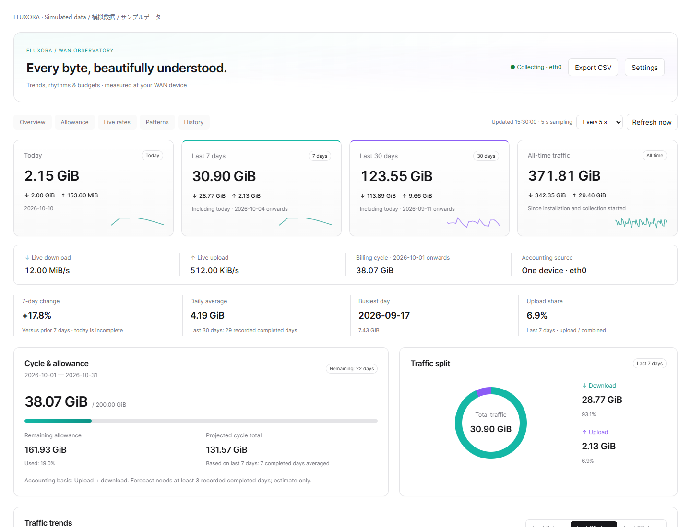
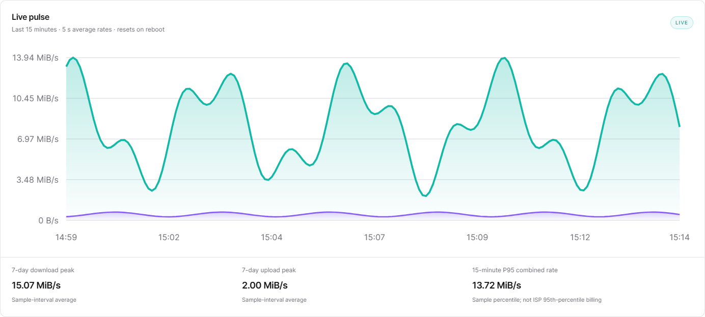
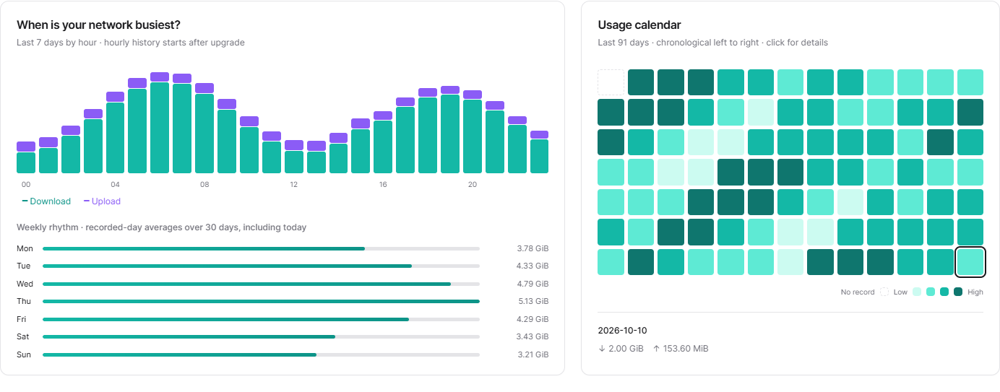
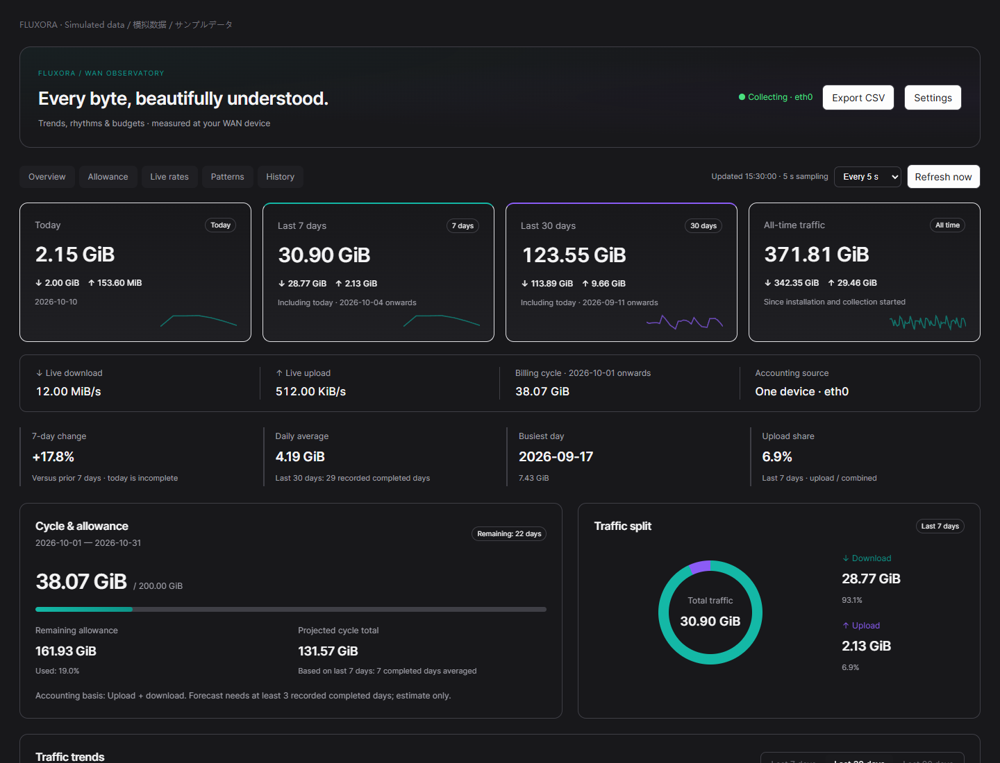
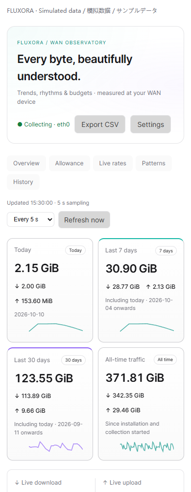

<div align="center">


**让每一份流量，都看得清楚。原生 LuCI 外网流量观察站。**

[](https://github.com/cndoin/luci-app-fluxora/releases)
[](https://github.com/cndoin/luci-app-fluxora/actions)
[](LICENSE)


[English](README.md) · **简体中文** · [日本語](README.ja.md)

[下载安装包](https://github.com/cndoin/luci-app-fluxora/releases/latest) · [兼容性与测试](docs/COMPATIBILITY.md) · [更新记录](CHANGELOG.md)

</div>



图片由实际代码和**模拟数据**生成。插件在 LuCI 内运行，不部署独立网站或 GitHub Pages；界面也提供中文、英文、日文。

## 功能一览

| 视图 | 内容 |
| --- | --- |
| 总览 | 今日、近 7 天、近 30 天、累计总流量，分别显示上传 / 下载 |
| 实时 | 速率、15 分钟曲线、采样峰值、短窗 P95、带宽利用率 |
| 节奏 | 24 小时分布、星期平均、91 天可点击日历、用量 TOP 5 |
| 账期 | 每月开始日、额度、计费口径、剩余用量与预测 |
| 历史 | 日 / 账期 / 自然月 / 年分页记录、CSV 导出 |
| 接口 | 报文、驱动错误 / 丢弃、有效采样时长 |

浅色 / 深色、自适应布局、轻柔动画。动画可关闭，也尊重系统“减少动态效果”。刷新可选 2、5、10、15、30、60 秒或手动；标签页隐藏时暂停请求，后台采样继续。

<details>
<summary>实时曲线、日历、深色与手机界面</summary>






</details>

## 安装

按**包管理器**选文件。插件没有 CPU 专用二进制，ARM32、ARM64、x86/64 使用同一个 `all.ipk` / `noarch.apk`。ARM / x86 ZIP 便捷下载包包含相同的通用文件。

| 系统 | 文件 |
| --- | --- |
| OpenWrt 23.05 / 24.10、使用 opkg 的 iStoreOS 24.10 | `luci-app-wan-traffic_1.4.0-1_all.ipk` |
| 使用 apk 的 OpenWrt 25.12 | `luci-app-wan-traffic-1.4.0-r1.apk` |
| 其他分支 / 自编译 / Snapshot | 核对包管理器并阅读[兼容性说明](docs/COMPATIBILITY.md) |

上传到 `/tmp`，执行：

```sh
# opkg 系统
opkg install /tmp/luci-app-wan-traffic_1.4.0-1_all.ipk

# apk 系统：社区包未使用 OpenWrt 官方密钥签名
apk add --allow-untrusted /tmp/luci-app-wan-traffic-1.4.0-r1.apk
```

缺少依赖时先执行 `opkg update` 或 `apk update`，再安装。用 Release 的 `SHA256SUMS` 核对文件；不能通过改后缀把 IPK 变成 APK。

重新登录，打开 **服务 → Fluxora 流光 → 手动配置**，修改后使用 LuCI 底部“保存并应用”。已有 `luci-app-wan-traffic` 直接升级，保留配置和历史，软件包标识不改名。

新安装自动解析逻辑 `wan`；必要时填写固定设备，如 `eth0`。只选**一个真实外网口**，wan / wan6 共用一个设备时不要叠加。每月账期开始日可设 1–28 日，切换只重新归组，不清空日记录。

## OpenClash / UA3F 与边界

只统计选定 WAN 的 RX / TX，包括 IPv4、IPv6、路由器通信、真实代理开销和重传。不将 LAN、TUN、OpenClash、UA3F 面板计数加到总量；默认拒绝常见虚拟接口，高级配置可明确放行一个。

避免的是统计层重复，不能去掉真正经过 WAN 的报文，也不保证和校园网 / 运营商账单一致。只计下载的账单请选择“仅下载”；不要随意将数据乘 0.5。

- 安装前流量不能恢复。
- 日记录保存在 `/etc/wan-traffic/`，正常重启保留；突然断电最多可能丢失一个保存间隔，默认 60 秒。
- 小时记录保留 90 天；180 条短期速率样本在 RAM，重启后重新积累。
- 近 7 / 30 天包含今天，按路由器自然日计算。
- 预测需要至少 3 个已记录结束日，仅供参考。驱动丢弃不是端到端丢包率。
- 单网口计数无法可靠生成客户端、应用或域名排行。

## 轻量运行与验证

后台每 5 秒采样，页面刷新更快不会提高采样精度。实时数据与每分钟历史同步分开，复用图表节点，避免请求重叠，离开页面清理监听和动画。路由器无需数据库、Python、Node、React、抓包程序或 CDN。

测试覆盖增量 / 归零、重启、整点归档、虚拟接口、大计数器、安装与浏览器交互；连续 250 次刷新节点数稳定，最多一个并发请求。实际 opkg / apk 与 ARM 模拟检查的范围见[测试矩阵](docs/COMPATIBILITY.md)，不宣称所有硬件或魔改固件都已长期验证。

## 开发与协议

```sh
python3 build.py
python3 build.py --format all   # 需要 apk-tools v3
python3 test_backend.py
npm ci && npx playwright install chromium
npm test
```

包含 OpenWrt SDK / buildroot `Makefile`、CI、问题模板与[贡献指南](CONTRIBUTING.md)。Python / Node 仅用于开发。

[MIT](LICENSE) 开源。视觉参考 AnxForever 的 MIT shadcn analytics template，保留其[许可证](root/usr/share/doc/luci-app-wan-traffic/TEMPLATE-LICENSE)，采用原生 LuCI 实现。参考 [vnStat](https://github.com/vergoh/vnstat)、[nlbwmon](https://github.com/jow-/nlbwmon) 与 [Linux 网卡统计](https://docs.kernel.org/networking/statistics.html)。
